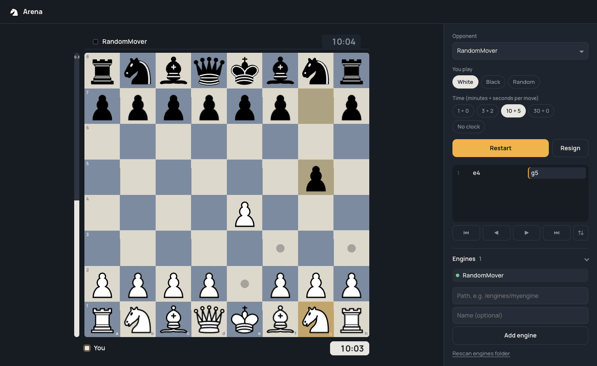

# Chess Arena

A clean chess GUI for playing against your own UCI engines. You can move pieces by dragging or by clicking, as on chess.com.



## Run it

```sh
docker compose up --build -d
npm run engine-host        # only for macOS engines; keep it running (Node 22.18+, no npm install needed)
open http://localhost:3000
```

Without Docker: `npm install`, then `npm run dev` and open http://localhost:5173. This needs Node 22+, Rust with `rustup target add wasm32-unknown-unknown`, and `cargo install wasm-bindgen-cli --version 0.2.129`.

## Add your engines (and their versions)

Click **Add engine** and pick the engine file in your file manager. It's saved as `engines/<engine>/v1/`. To include network files (NNUE etc.), select them together with the engine.

**New versions:** click **+ version** next to an engine and pick the updated file. It's saved as `v2`, `v3`, … next to the old ones, and all versions stay playable. Uploading a file with the same name as an existing engine also adds a new version. You can also make the folders yourself (`engines/<engine>/<version>/`) and click **Rescan engines folder**.

## Engine strength (Elo)

Engines that can play at a set Elo (UCI options `UCI_LimitStrength` + `UCI_Elo`, e.g. Stockfish) get a strength dropdown next to them: **Full strength** or Elo values across the engine's range (Stockfish 19: 1320–3190). It's available in **Play** for your opponent and in **Match** for engine A and B separately. The chosen Elo shows in the player's name, e.g. "stockfish 19 (Elo 1500)".

## Engine vs. engine

Open **Match** in the top bar, then pick engine A and engine B. Pick **1** under Games to watch a single engine-vs-engine game on the big board (engine A has White). By default, that's the newest version against the one before it. Then choose:
- the number of games (100 to 10,000)
- the time per move
- how many boards play at once (16 to 200)

A match runs any number of games on screen, but each engine only gets one process per two CPU cores. Games share those processes move by move, so 100 boards don't need 200 engine processes. Memory stays bounded, and every move is calculated with a full CPU core. A game's clock only runs while its engine is actually thinking.

Every running game is a live mini board. A board flashes the result in A's color (amber), B's color (blue) or grey for a draw, then starts its next game. Colors swap every game. The panel shows A wins / draws / B wins, A's score and the Elo difference with a 95% margin.

- **Live boards: Hide** turns off the grid and shows only the big score, which is lighter when running thousands of games.
- **Click any small board** to watch that game large, with clocks, eval and move list. ← → step through its moves. **← All boards** or Esc goes back. The big board follows that board, so when its game ends it continues with that board's next game.

Every game starts from the normal starting position. An engine that always plays the same move in the same position plays the same game every time.

- Executables, `*.py` and `*.js` files (top level or one folder deep) are found automatically. The engine runs with its own folder as the working directory, so NNUE files next to it load.
- **macOS engines with Docker:** the container runs Linux, so native macOS binaries run on your Mac through the **engine host** (`npm run engine-host`). The container connects to it on `host.docker.internal:7100`, and those engines show a `macOS` tag. Linux builds and `*.py`/`*.js` engines run inside the container. To run a script engine on the Mac as well, add `"host": true` to its `engines.json` entry.
- The engine host only starts files inside `engines/`. It listens on 127.0.0.1 only and requires the token in `engines/.engine-host-token`, which it creates on first start.
- Click an engine's name to rename it.
- Each board in a match runs its own two engine processes, so 100 boards means 200 processes.
- Names, arguments and UCI options go in `engines/engines.json`:

```json
[{ "name": "My Engine", "command": "my-engine/engine", "args": [], "options": { "Hash": 64, "Threads": 2 } }]
```

## Controls

| Action | How |
| --- | --- |
| Move | Drag a piece, or click it and then click the target square |
| Draw an arrow / mark a square | Right-drag / right-click (left-click clears) |
| Step through moves | ← → (↑ first move, ↓ back to live) |
| Flip board | F |

## Development

```sh
npm run dev        # builds core/, then server (tsx watch) + Vite client
npm test           # cargo tests for core/ + vitest (UCI, game rules, engine host)
npm run typecheck
npm run core       # rebuild the chess rules (core/ → core/pkg) after editing Rust
```

Chess rules (legal moves, SAN, FEN, checkmate, repetition, 50-move rule, insufficient material) come from [shakmaty](https://crates.io/crates/shakmaty). It's compiled to WebAssembly in `core/`, and the server and the browser load the same module.

Everything (built and planned, including engine-vs-engine matches and the 100+ board grid) is in [PLAN.md](PLAN.md).

Piece set: cburnett by Colin M.L. Burnett (GPLv2+), from lichess.
